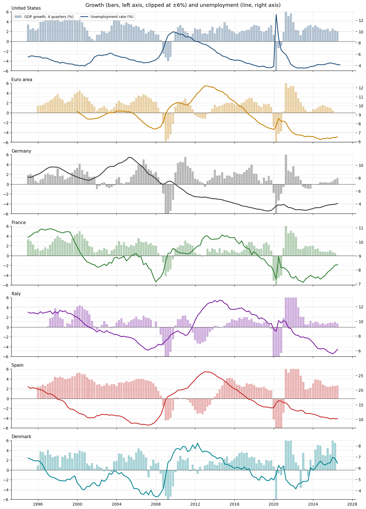
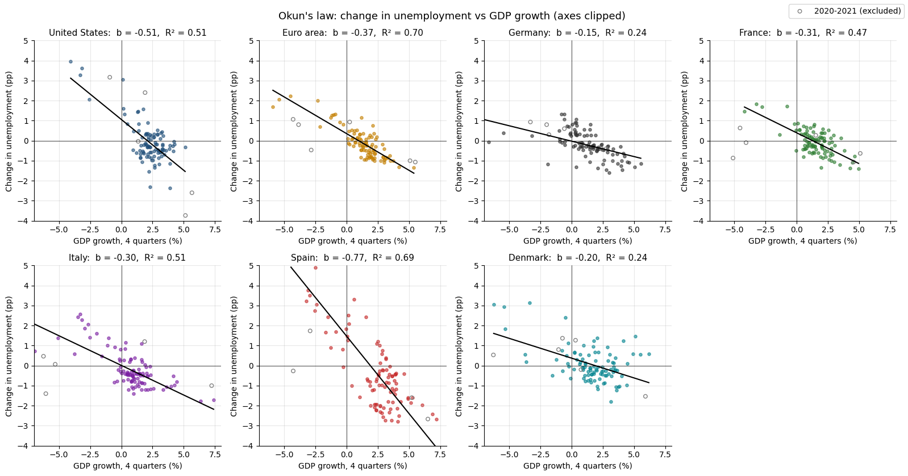
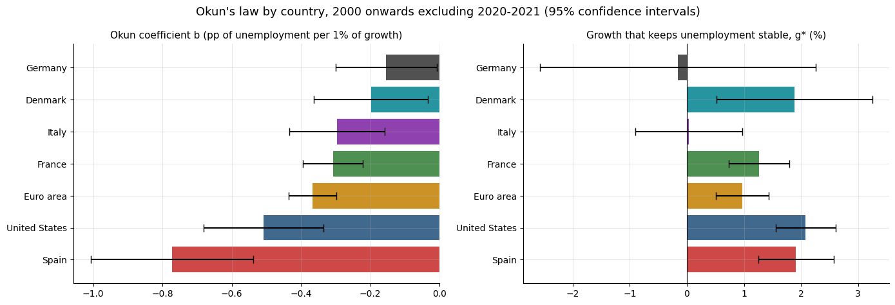
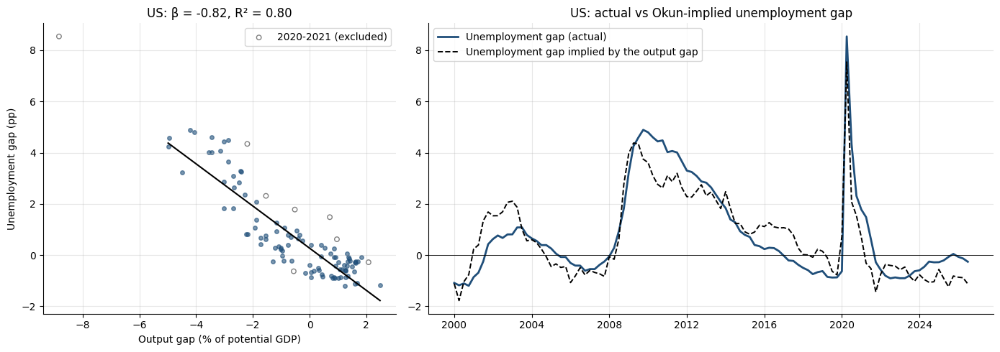
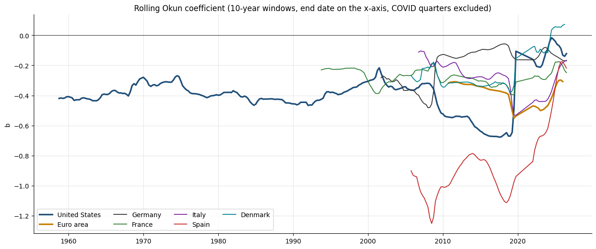
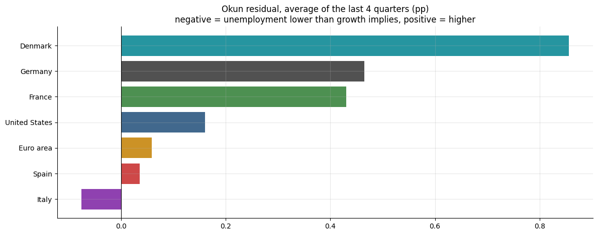
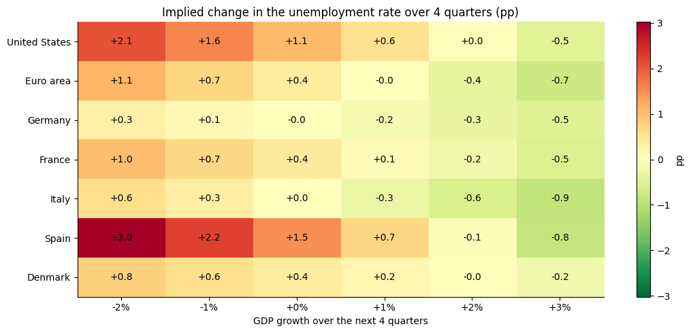

# Okun's Law Across Countries: Growth, Unemployment and the Labour Market

[](https://colab.research.google.com/github/gabsmm18/okun-law-analysis/blob/main/okun_law_analysis.ipynb)

**Author:** Mattia Mariani
## Summary

This project estimates Okun's law, the relationship between economic growth and unemployment, for the **United States, the euro area, Germany, France, Italy, Spain and Denmark**. It asks how strongly unemployment reacts to growth, whether this relationship is stable, and what it says about today's labour markets.

**Key findings:**

1. **Unemployment reacts to growth five times more in Spain than in Germany.** One extra point of GDP growth lowers unemployment by **0.77 pp in Spain**, 0.51 pp in the US and 0.37 pp in the euro area, but only **0.15 pp in Germany**. The differences reflect labour-market institutions: temporary contracts in Spain, short-time work and labour hoarding in Germany.
2. **Okun's law is learned from recessions.** The coefficient is identified mainly by large downturns such as 2008-09. In calm periods with steady growth, the relationship looks flat: the US coefficient after 2010 is close to zero (−0.06) and not significant.
3. **In the US, the gap version is strong but steep.** Each point of output gap moves the unemployment gap by **0.82 pp** (R² = 0.80), above Okun's classic rule of thumb of about 0.5.
4. **Labour markets look weaker than growth implies in Denmark, Germany and France.** Over the last four quarters unemployment rose by 0.4-0.9 pp more than Okun's law predicts given GDP growth.
5. **The US labour market points to a smaller output gap than the CBO.** Today's unemployment is close to its natural rate, which through Okun's law implies an output gap of roughly +0.6%, against +1.7% in the CBO estimate. This matters for Taylor-rule assessments of Fed policy (see the companion project [taylor-rule-tracker](https://github.com/gabsmm18/taylor-rule-tracker)).

## Research question

How much does unemployment respond to economic growth in the US and in Europe? Has this relationship changed over time, and is today's labour market behaving as growth would imply?

Okun's law is a standard tool for macro strategists and central banks. It translates GDP forecasts into unemployment forecasts, gives a real-time proxy for the unobservable output gap, and flags when the labour market diverges from the business cycle.

## Okun's law

**Difference version** (all countries):

$$\Delta u_t = a + b\, g_t + \varepsilon_t$$

| Symbol | Meaning |
|---|---|
| $\Delta u_t$ | Change in the unemployment rate over 4 quarters (pp) |
| $g_t$ | Real GDP growth over 4 quarters (%) |
| $b$ | **Okun coefficient**: change in unemployment for each extra point of growth |
| $g^* = -a/b$ | Growth rate that keeps unemployment stable, a rough measure of potential growth |


## Data

| Variable | United States | Europe |
|---|---|---|
| Real GDP | FRED (BEA) | Eurostat via FRED, ECB Data Portal as backup |
| Unemployment rate | FRED (BLS) | ECB Data Portal: Eurostat harmonised rate, age 15-74 |
| Potential GDP, natural rate of unemployment | CBO via FRED | |

- Quarterly, seasonally adjusted data; monthly unemployment averaged to quarters.
- 4-quarter changes are used instead of quarter-on-quarter changes to remove most of the noise in quarterly data.
- Main estimation sample: **2000Q1 to the latest quarter (2026Q3 for most countries), excluding 2020-2021**. During COVID, GDP collapsed and rebounded within months while job-retention schemes kept European unemployment almost unchanged, which would distort the normal relationship.
- Standard errors are HAC-robust, because overlapping 4-quarter changes are mechanically autocorrelated. Standard errors of $g^*$ use the delta method.



## Results

### 1. Okun's law by country





| Country | Quarters | Okun b | s.e. | g* (%) | s.e. | R² |
|---|---|---|---|---|---|---|
| Spain | 99 | **−0.77** | 0.12 | 1.91 | 0.34 | 0.69 |
| United States | 99 | −0.51 | 0.09 | 2.08 | 0.27 | 0.51 |
| Euro area | 93 | −0.37 | 0.04 | 0.97 | 0.24 | 0.70 |
| France | 99 | −0.31 | 0.04 | 1.26 | 0.27 | 0.47 |
| Italy | 99 | −0.30 | 0.07 | 0.04 | 0.48 | 0.51 |
| Denmark | 98 | −0.20 | 0.08 | 1.88 | 0.70 | 0.24 |
| Germany | 99 | **−0.15** | 0.07 | −0.16 | 1.23 | 0.24 |

*Sample 2000Q1 to latest quarter, excluding 2020-2021. Euro area from 2001Q1.*

**The Okun coefficient.** All coefficients are negative and statistically significant: faster growth lowers unemployment everywhere. But the size varies a lot, and the ranking matches what we know about labour-market institutions:

- **Spain (−0.77)** has the most responsive labour market in the sample. A large share of temporary contracts means firms can shed jobs quickly in a downturn and hire quickly in a recovery: Spanish unemployment rose from about 8% to over 26% between 2007 and 2013.
- **The United States (−0.51)** is close to Okun's original estimates. Low employment protection makes hiring and firing relatively easy.
- **France and Italy (about −0.30)** are in the middle, with stronger employment protection.
- **Germany (−0.15)** and **Denmark (−0.20)** have the weakest relationship, with an R² of only 0.24. In Germany, firms adjust hours rather than headcount, through short-time work (*Kurzarbeit*) and working-time accounts: in 2009 German GDP fell by almost 6% while unemployment barely rose, the so-called "German labour market miracle".

**Growth needed to keep unemployment stable (g\*).** For the US (2.1%), Spain (1.9%), Denmark (1.9%) and France (1.3%) the estimates are plausible measures of potential growth. For **Italy (0.0%)** and **Germany (−0.2%)** they are not, and the large standard errors confirm it. Two reasons:
- when the Okun coefficient is small, $g^* = -a/b$ divides by a number close to zero and becomes very imprecise;
- German unemployment fell from about 11% in 2005 to about 3-4% in the 2010s mainly because of the Hartz labour-market reforms, not because of growth. The model attributes this structural decline to the constant, which pushes g* below zero.

### 2. Gap version (United States)



| | β | s.e. | R² | Quarters |
|---|---|---|---|---|
| United States, 2000-2026 excl. 2020-21 | **−0.82** | 0.09 | 0.80 | 99 |

The gap version fits much better than the difference version (R² of 0.80 vs 0.51), but the coefficient is steeper than Okun's rule of thumb of about −0.5. One reason to be careful: the CBO estimates potential GDP partly *from* the unemployment gap, so the two gaps are not fully independent and the fit is partly built in.

**Link to monetary policy.** The right-hand chart shows the unemployment gap that the CBO output gap would imply, against the actual one. Since 2023 actual unemployment has drifted **above** the implied path: the labour market is looser than the CBO output gap suggests. With unemployment close to its natural rate, Okun's law implies an output gap of roughly **+0.6%**, against the CBO's **+1.7%**.

This matters for the [Taylor Rule Tracker](https://github.com/gabsmm18/taylor-rule-tracker). With a +0.6% output gap the rate prescribed by the Taylor rules falls by about 0.6 pp (original rule) to 2.0 pp (estimated Fed rule). The rules would still prescribe a rate above the current 3.88%, so the conclusion that Fed policy is accommodative survives, but the size of the gap is much smaller.

### 3. Stability over time



| Country | Before 2008: from | b before 2008 | s.e. | b after 2010 | s.e. | Change |
|---|---|---|---|---|---|---|
| United States | 1949Q1 | −0.39 | 0.02 | −0.06 | 0.16 | +0.33 |
| Euro area | 2001Q1 | −0.44 | 0.05 | −0.44 | 0.08 | 0.00 |
| Germany | 1992Q1 | −0.40 | 0.06 | −0.20 | 0.04 | +0.20 |
| France | 1984Q1 | −0.26 | 0.06 | −0.28 | 0.06 | −0.02 |
| Italy | 1997Q1 | −0.12 | 0.05 | −0.43 | 0.10 | −0.31 |
| Spain | 1996Q1 | −0.88 | 0.25 | −0.67 | 0.11 | +0.21 |
| Denmark | 1996Q1 | −0.24 | 0.06 | 0.02 | 0.07 | +0.26 |

*Positive change = unemployment less sensitive to growth after 2010. The pre-2008 samples start when data become available, so they differ by country.*

**The main lesson: Okun's law is learned from recessions.** The rolling chart shows that the US coefficient was remarkably stable at around −0.4 from the 1950s to the 2000s, then steepened to about −0.67 while the 2008-09 recession was inside the 10-year window, and jumped towards zero once it left. The same pattern appears in most countries. In periods of steady growth, both growth and unemployment move little and the slope cannot be estimated precisely. This is why the post-2010 US coefficient (−0.06) is close to zero and not significant: the expansion after 2010 had steady growth of about 2% and a slow, continuous fall in unemployment.

**Changes that look structural:**
- **Italy became more responsive** (−0.12 to −0.43). This is consistent with the labour-market reforms of the 2010s (the Fornero reform and the *Jobs Act*), which made dismissals easier and expanded fixed-term contracts.
- **Germany became less responsive** (−0.40 to −0.20), consistent with the wider use of short-time work after 2009.
- **Denmark's relationship has almost disappeared** after 2010 (0.02). See the discussion of Danish GDP below.

### 4. Today's labour market



| Country | Latest quarter | Unemployment (%) | Growth, 4q (%) | Change in unemployment, 4q (pp) | Okun-predicted (pp) | Residual, avg last 4q (pp) |
|---|---|---|---|---|---|---|
| United States | 2026Q3 | 4.13 | 2.04 | −0.20 | 0.02 | 0.16 |
| Euro area | 2026Q1 | 6.47 | 0.49 | 0.13 | 0.18 | 0.06 |
| Germany | 2026Q3 | 4.07 | 1.24 | 0.27 | −0.22 | **0.46** |
| France | 2026Q3 | 8.37 | −0.07 | 0.53 | 0.41 | **0.43** |
| Italy | 2026Q3 | 6.20 | 0.75 | 0.33 | −0.21 | −0.08 |
| Spain | 2026Q3 | 10.23 | 2.63 | −0.27 | −0.55 | 0.04 |
| Denmark | 2026Q2 | 6.83 | 5.50 | 0.57 | −0.71 | **0.86** |

*Residual = actual minus Okun-predicted change in unemployment. Positive = unemployment higher than growth would imply.*

- **United States, euro area, Spain, Italy: in line with Okun's law.** Average residuals over the last year are small (below 0.2 pp). The US labour market is cooling gently, consistent with growth of about 2%. Italy's latest quarter shows a large residual (+0.54 pp), but it is not yet visible in the 4-quarter average: one to watch.
- **Germany (+0.46 pp): unemployment is rising faster than growth implies.** With GDP up 1.2%, Okun's law predicts a small fall in unemployment, but it has risen. This is consistent with job losses in German manufacturing, where firms have been cutting jobs even as overall output recovers. It is the opposite of the labour hoarding of 2009.
- **France (+0.43 pp): a weak economy with a weakening labour market.** GDP is flat and unemployment is rising, somewhat more than the stagnation alone would explain.
- **Denmark (+0.86 pp): the largest gap.** GDP has grown 5.5% over the year, but unemployment has *risen*. Danish GDP in recent years has been heavily influenced by the pharmaceutical industry, whose output can grow fast with relatively few domestic jobs, so GDP growth says less about the labour market than in other countries. This also explains the weak Danish Okun relationship after 2010. In addition, the Eurostat harmonised unemployment rate for Denmark is volatile and much higher than the national registered rate, because the survey counts students looking for work.

**Why it matters for a strategist:** when unemployment rises more than growth implies, the labour market is likely to weigh on consumption ahead of GDP. For Germany and France this is a downside risk to growth forecasts, and an argument against further tightening by the ECB.

### 5. Scenarios



Implied change in the unemployment rate over four quarters (pp), from each country's estimated relationship:

| Country | −2% | −1% | 0% | +1% | +2% | +3% |
|---|---|---|---|---|---|---|
| United States | +2.07 | +1.57 | +1.06 | +0.55 | +0.04 | −0.47 |
| Euro area | +1.09 | +0.72 | +0.36 | −0.01 | −0.38 | −0.74 |
| Germany | +0.28 | +0.13 | −0.02 | −0.18 | −0.33 | −0.49 |
| France | +1.00 | +0.70 | +0.39 | +0.08 | −0.23 | −0.53 |
| Italy | +0.60 | +0.31 | +0.01 | −0.28 | −0.58 | −0.88 |
| Spain | +3.02 | +2.25 | +1.48 | +0.70 | −0.07 | −0.84 |
| Denmark | +0.77 | +0.57 | +0.37 | +0.17 | −0.02 | −0.22 |

- **A mild US recession** (GDP −1% over a year) would raise unemployment by about **1.6 pp**, from about 4.1% to 5.7%. A stall at 0% growth would add about 1 pp.
- **Spain is the most exposed**: the same −1% would raise unemployment by 2.3 pp.
- **For Germany and Italy** the scenarios are less reliable, because the relationship is weak (Germany) or g* is implausible (both). In Germany they would understate the rise in unemployment if the current manufacturing job losses continue.

## Conclusions

1. **Okun's law holds in all seven economies, but its strength differs by a factor of five**, in line with labour-market institutions: flexible, temporary-contract labour markets (Spain, US) react strongly; markets where firms adjust hours (Germany) react weakly.
2. **The relationship is driven by recessions.** Estimates from calm periods are flat and imprecise, so Okun's law is most useful exactly when it matters most: in a downturn.
3. **Structural reforms move the coefficient.** Italy's labour market became more responsive after the reforms of the 2010s, Germany's less responsive after the spread of short-time work.
4. **Today, labour markets in Germany, France and Denmark are weaker than GDP suggests**, while the US and the euro area as a whole are in line with growth.
5. **For US monetary policy, the labour market points to a smaller output gap than the CBO**, which weakens, but does not overturn, the conclusion that Fed policy is accommodative.

## Limitations

- **A statistical regularity, not a structural model.** Okun's law summarises past behaviour of firms, workers and institutions, and changes when they change.
- **Identification comes from recessions.** With only one or two large downturns per country since 2000 (2008-09 and the euro crisis), the coefficients rest on a small number of episodes.
- **Data revisions.** GDP is revised substantially after its first release, while unemployment is rarely revised; real-time estimates would be weaker.
- **Labour supply.** Participation, migration and demographics move unemployment independently of growth: the strong immigration-driven growth in the labour force in several countries after 2022 is not captured.
- **Excluding COVID** keeps the normal relationship clean but ignores how job-retention schemes changed labour-market adjustment.
- **Constant g\*.** A single potential growth rate for 25 years averages across periods with different productivity and labour-force growth.
- **Country-specific measurement issues**, notably Danish GDP (pharmaceutical sector) and the gap between survey-based and registered unemployment.

## Possible extensions

- **Asymmetry:** does unemployment rise faster in recessions than it falls in recoveries?
- **Hours vs jobs:** splitting adjustment into hours worked per employee and employment
- **Time-varying coefficients** with a state-space model (Kalman filter)
- **Real-time recession signal** combining Okun's law with the Sahm rule
- **Denmark with GDP excluding pharmaceuticals** and registered unemployment

## How to run

**Google Colab (recommended)

```

## References

- Ball, L., Leigh, D. and Loungani, P. (2017). Okun's law: fit at 50? *Journal of Money, Credit and Banking*, 49(7), 1413-1441.
- Knotek, E. S. (2007). How useful is Okun's law? *Federal Reserve Bank of Kansas City Economic Review*, Q4, 73-103.
- Okun, A. M. (1962). Potential GNP: its measurement and significance. *Proceedings of the Business and Economic Statistics Section, American Statistical Association*, 98-104.


